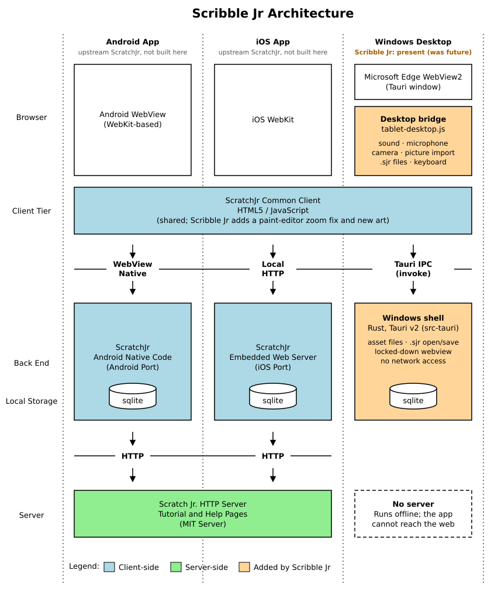

# Scribble Jr

Scribble Jr is a free Windows app where young children (ages 5–7) snap together
picture blocks to make characters move, jump, dance and sing. It is built from
the open-source code of [ScratchJr](https://www.scratchjr.org/), made to work with
a keyboard and mouse on Windows, with an all-new, openly licensed art library.

Code by Peter Rafferty, art direction by James Rafferty.

> Scribble Jr is an independent project. It is not affiliated with or endorsed by
> MIT, Tufts University or the Scratch Foundation. "Scratch", "ScratchJr" and the
> Scratch Cat are trademarks of MIT and are not used by this app.

## Status

| Platform | Status |
|---|---|
| Windows (desktop) | Current: built from this repository |
| iOS, Android | Not built by Scribble Jr; the `ios/` and `android/` folders are upstream ScratchJr code, left unchanged |

## Installing and running on Windows

Run `Scribble Jr_<version>_x64-setup.exe` (from a [build](#building) or the
GitHub Actions artifact). It installs for the current user only, so no
administrator rights are needed, and adds Scribble Jr to the Start menu and to
Settings → Apps, where it can be uninstalled.

- **Windows 10 or 11.** The app uses Microsoft Edge WebView2, which both already
  include; if it is missing, the installer downloads it.
- **Projects are stored locally** in `%APPDATA%\io.github.rhyobit.scribblejr\`
  (`projects.db` plus a `files\` folder for drawings, photos and sounds).
  Uninstalling keeps them unless you tick the uninstaller's option to delete
  the app data.
- **Touchscreens work** as well as mouse and keyboard.

## What's different from ScratchJr

ScratchJr is a tablet app for iPad and Android. Scribble Jr runs the same web
client inside a small native Windows app (Tauri + WebView2), with a Windows
replacement for the tablet's native layer and all trademarked art replaced.

### Windows app

- **Native layer rewritten for Windows.** [`desktop/tablet-desktop.js`](desktop/tablet-desktop.js)
  and [`desktop/src-tauri/`](desktop/src-tauri/) do what ScratchJr's iOS code does:
  - **Storage:** SQLite, behaving exactly as the iOS database layer does.
  - **Assets:** drawings, photos and sounds are saved as files.
  - **Sound:** playback, plus microphone recording as 16-bit mono WAV, so
    projects stay compatible with the tablet apps.
  - **Camera:** photo capture in the paint editor.
- **Project files.** The share button's "Email" and "AirDrop" options both
  become "Save to file", which writes a `.sjr` project. "Open project" on the
  home screen imports a `.sjr`, including ones made in ScratchJr.
- **Picture import.** The paint editor's camera tool also offers "Choose a
  picture", which fills a shape from an image file. It works on PCs with no
  camera.
- **Private and locked down.**
  - No analytics or telemetry.
  - The app cannot browse the web or open pop-ups.
  - Only the app's own pages get the microphone and camera.
  - File names from the page are checked so nothing can be written outside the
    app's data folder.
  - SQL `ATTACH` is blocked.

### Fixes for moving from tablet to desktop

ScratchJr was written for touch on iPad's WebKit. Running it on a desktop
Chromium engine (WebView2) with a mouse exposed several problems. These are
fixed here:

- **Paint editor: shapes appeared up and to the left of the pointer.**
  `PaintAction.zoomPt` compared the SVG screen matrix with the editor's zoom
  for exact equality. Chromium stores that matrix as 32-bit floats, so the
  comparison failed and every point was divided by the zoom twice. At
  1366×768 the offset was about 118 × 105 px. The comparison now allows a small
  tolerance (`src/painteditor/PaintAction.js`, version 1.0.1).
- **Paint bucket, camera and picture fill did nothing inside outlined shapes.**
  The editor finds shapes with `getIntersectionList()`. WebKit matches by
  bounding box, but Chromium only matches painted pixels, so clicking inside an
  unfilled shape missed it. The bridge restores WebKit's bounding-box behaviour.
- **Touch versus mouse mode.** ScratchJr picks touch handlers whenever the
  browser reports touch support, which broke mouse input on touchscreen PCs.
  The app now always runs in mouse mode. Touch still works, because Windows
  turns touches into mouse events.
- **Block number pad.** The on-screen keypad was touch-only. It now also
  accepts typed digits, minus, Backspace and Delete, with Enter or Escape to
  finish. Clicking outside the pad also finishes the edit.
- **Window resizing and zoom.** ScratchJr lays out each page once, from the
  screen size. Resizing the window on the home screen reloads the layout.
  Resizing in the editor does not reload, so no work is lost. Browser zoom
  (Ctrl + wheel, Ctrl +/−) and the right-click menu are turned off, except in
  text fields.
- **Sound.** Browsers keep audio paused until the user clicks or presses a
  key. The bridge resumes it on the first click, tap or key press, so block
  sounds play straight away.
- **No intro video.** The original video shows ScratchJr trademarks. The intro
  screen now points to the in-app guides instead.

### Open-source art

Every trademarked or unlicensed asset from ScratchJr has been replaced (see
[CREDITS.md](CREDITS.md) and [desktop/open-art/](desktop/open-art/README.md)):

- **New:**
  - the logo, start screen and app icon
  - the mascots Tabby, Plum, Nova and Sparky
  - 20 original backgrounds
  - new help-guide screenshots

  All of these are CC0, and most are generated by scripts in
  `desktop/open-art/tools/`.
- **Characters:** 147 library characters from [Twemoji](https://github.com/jdecked/twemoji)
  (CC BY 4.0). They were converted, not redrawn, into the restricted SVG that
  ScratchJr's paint editor can edit: paths only, cubic curves, no group styles.
- **Interface art:** buttons, block icons and sounds remain ScratchJr's own
  BSD-licensed open-source assets.
- **App name:** the app is renamed in all 20 languages. An "independent, not
  affiliated" note has been added, and the original ScratchJr credits stay on
  the About page.

## Building

Requirements: Node.js 20+, Rust (stable) and the Visual Studio C++ build tools.

```bash
npm ci --ignore-scripts
NODE_OPTIONS=--openssl-legacy-provider npx webpack --mode=production
cd desktop
npm ci
npx tauri build
```

The installer is written to `desktop/src-tauri/target/release/bundle/nsis/`.

Every push to `main` also builds the installer on GitHub Actions
([Windows build](.github/workflows/windows-build.yml)). The installer and app
`.exe` are attached to each run as an artifact for 30 days.

How the pieces fit:



The diagram follows the original ScratchJr architecture diagram, which drew a
desktop version as future work. Scribble Jr is that desktop version, but built as
an offline Windows app rather than a website.

| Path | What it is |
|---|---|
| `src/`, `editions/free/src/` | The ScratchJr web client (lightly modified: rename, paint-editor zoom fix, new art, no intro video) |
| `desktop/tablet-desktop.js` | Replaces ScratchJr's iPad native layer: sound, microphone, camera/picture import, `.sjr` files |
| `desktop/src-tauri/` | Windows shell in Rust: SQLite storage, file dialogs, locked-down webview |
| `desktop/assemble.mjs` | Builds `desktop/dist` from the web client plus `desktop/open-art` |
| `desktop/open-art/` | All new artwork and the tools that generate it |
| `desktop/harness/` | Developer test server that runs the app in a normal browser |

## Licences

- Code: BSD 3-Clause, see [LICENSE](LICENSE) (ScratchJr © MIT; Scribble Jr changes © Peter Rafferty, James Rafferty and contributors).
- Art: see [CREDITS.md](CREDITS.md). Character art is Twemoji (CC BY 4.0); everything drawn for Scribble Jr is CC0.
- Third-party software: see [THIRD-PARTY-NOTICES.md](THIRD-PARTY-NOTICES.md).

The original ScratchJr README is kept in [doc/ORIGINAL-SCRATCHJR-README.md](doc/ORIGINAL-SCRATCHJR-README.md)
for reference.
